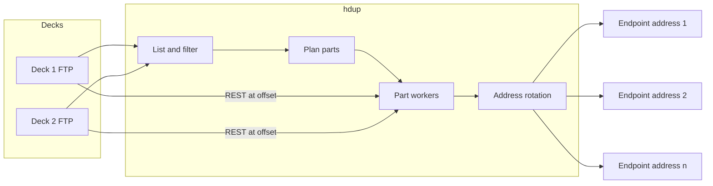

# Design

## Problem

A HyperDeck gives access to its recordings through FTP. To move recordings
to S3 storage with one `rclone copy` for each deck has two problems for large
files:

- The upload rate is limited by the number of connections, and one slow
  internet path makes each connection slow.
- A multipart upload that is interrupted starts again from the first byte.

## Goals

- Open many connections, spread across all addresses of the S3 endpoint.
- Make the upload rate equal to the rate that the decks can supply.
- Continue an interrupted upload without a second upload of completed parts.
- Use one command and one job file for all decks.

## Not in scope

- Sources other than FTP. Destinations other than S3.
- Sync, delete or download functions.
- A local staging copy.

## Data path

Each deck has a fixed number of workers. A worker does these steps for one
part:

1. Open an FTP connection to the deck.
2. Send `REST <offset>` and `RETR`, and read one part into memory.
3. Close the FTP connection. The worker does not wait for the reply of the
   deck, because `RETR` would continue to the end of the file.
4. Calculate the MD5 of the part.
5. Send `UploadPart` with `Content-MD5`.

No local disk is used. Memory use is approximately
decks × parts for each deck × part size.

## Packages

| Package | Function |
|---|---|
| `cmd/hdup` | Flags, signals, wiring. |
| `internal/job` | Read the job file. Read the remotes from the hdup config file or the rclone config file. |
| `internal/source` | List deck files. Read a byte range through FTP. |
| `internal/plan` | Calculate the part size and the part list for a file. |
| `internal/balance` | Resolve the endpoint. Rotate new connections across its addresses. |
| `internal/upload` | Upload one file: skip, single part, multipart, resume. |
| `internal/run` | Preview, confirmation, deck workers, progress, summary, JSON lines. |
| `internal/probe` | Measure the upload rate with generated data. |
| `internal/fake` | S3 and source substitutes in memory, for tests. |

## List and filter

The decks do not support `MLSD`, so `hdup` uses `LIST`. It gets the time of
each file with `MDTM` if the deck has that command. If not, it uses the time
from `LIST`, which has a precision of one minute. A file is selected if its modified time is in the date
window and its path matches an `include` pattern.

An entry name that contains `/` is rejected, because it could put an object
outside the prefix of its deck.

## Explicit file list

A job file with `[[file]]` entries gives the deck, the path and the object
key of each file. `hdup` does not list the deck. It opens one connection to
each deck and gets the size (`SIZE`) and the modified time of each file. The
time comes from `MDTM`, or from the `LIST` of the directory of the file if
the deck has no `MDTM`. This check makes one try, so a deck that is off costs one connect
timeout of 10 seconds. A file that the deck cannot give, and each file of a
deck that does not answer, fails. The other files continue.

## Part plan

The part size is fixed for a given file size, so a second run calculates the
same parts. The size is the `--part-size` value, doubled until the file needs
no more than 10,000 parts. A file that is not larger than one part is sent
with one `PutObject`.

## Address rotation

`hdup` resolves the endpoint one time at start. The HTTP transport uses a
dial function that connects to the next address in the list for each new
connection. TLS uses the endpoint name, so certificates and request
signatures stay valid.

- HTTP/2 is off. HTTP/2 would put all requests on one connection.
- The client uses path-style addresses, so all requests use the one endpoint
  host name.
- If a dial to an address fails, that address is held back for 30 seconds.

## Bandwidth limit

`--bwlimit` sets one limiter that all send bodies share. Before a body gives
data to the HTTP client, it asks the limiter for a piece. The limiter gives
each piece a time slot at the set rate, and the body sleeps until its slot.
A piece is 1/64 of the bytes for one second, with a minimum of 1 KiB and a
maximum of 64 KiB. The pieces are small so that each connection moves data
continuously, and the idle rule of 3 minutes does not stop a slow part.
There is no burst: time that was not used is not saved.

## Resume

There is no local state. A run does this for each file:

1. Get the size of the file from the deck. If it is not the size from the
   list, the file fails. The file is possibly recording.
2. `HeadObject`. If the object exists with the same size, skip the file.
3. `ListMultipartUploads` for the key. An upload is usable if it started
   after the modified time of the source. Use the newest usable upload and
   abort the others.
4. `ListParts`. If a stored part does not agree with the part plan, abort the
   upload and start again.
5. Read the first and the highest stored part from the deck again. Compare
   the MD5 with the stored ETag. If they are different, abort the upload and
   start again.
6. Send the missing parts.
7. Get the size from the deck again. If it changed, the file fails.
8. `CompleteMultipartUpload`.

Step 5 is a compromise. The modified time of a deck has a precision of one
minute and comes from a different clock than the start time of the upload. A
full verification of all stored parts would read the complete stored range
from the deck again.

## Errors

- A read or a send that fails is tried again up to 10 times, with a delay
  that doubles to a maximum of 30 seconds. `--retries` changes the number.
- A connection to a deck must open in 10 seconds.
- A send has no fixed time limit. It stops if no data moves for 3 minutes.
- An FTP connection stops if the deck is silent for 60 seconds.
- S3 calls other than part sends have a limit of 2 minutes for each try.
- If `CompleteMultipartUpload` fails but the object exists with the correct
  size, the file counts as done. This is the case of a lost response.
- A file that fails does not stop the other files. A second run continues
  it. Multipart uploads are not aborted on failure or on Ctrl-C.

## Use from a different program

`--progress json` writes one JSON object on each line of the standard output
for each step of each file. The README gives the events. Each event of a
file has the deck, the path and the key, because decks run in parallel.

`--stdin-stop` stops the run when the standard input closes. Windows has no
`SIGINT` for a child process, and this also stops `hdup` when its parent
ends. A stop or a kill needs no clean-up: the storage service holds the
state, and the next run continues.

The hdup config file holds secrets as plain text. `hdup` refuses a config
file that the group or other users can read. Windows access comes from
ACLs, and `hdup` does not examine them. The two S3 keys can come from the
environment, so that a program does not have to write them to a file.

## Probe

`hdup probe` sends generated 4 MiB parts to a multipart upload for 20 seconds
in each of four cases, then aborts the upload:

| Connections | Addresses |
|---|---|
| 1 | 1 |
| 8 | 1 |
| 8 | 8 |
| 32 | 8 |

The result shows if the rate follows the number of connections, the number
of addresses, or neither.
